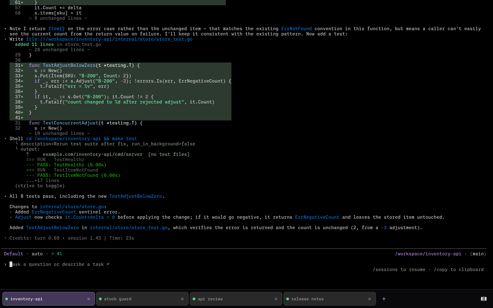

# Web Terminal for Kiro

[](https://github.com/cplieger/web-terminal-kiro/pkgs/container/web-terminal-kiro) [](https://github.com/cplieger/web-terminal-kiro/pkgs/container/web-terminal-kiro) [](https://github.com/cplieger/web-terminal-kiro/blob/main/Dockerfile) [](https://github.com/cplieger/web-terminal-kiro/issues?q=label%3Agremlins-tracker) [](https://github.com/cplieger/web-terminal-kiro/releases)

<!-- hub-overview BEGIN -->
Web Terminal for Kiro runs the Kiro CLI (`kiro-cli`) in your browser, from any laptop, tablet or phone, on a server you host. It shows kiro-cli's own terminal screen, with no chat layer on top.



## What it does

Work with the Kiro agent from any device and pick up each session where you left off.

- Gives each tab its own kiro-cli session, with a split view and a page address you can bookmark.
- Works on a phone, with on-screen keys for Tab, Esc, the arrows, Enter and Ctrl.
- Keeps each session running when you close the browser, your phone sleeps or the network drops.
- Marks each tab as working, done, failed or waiting for your answer.
- Installs the tools you list at each start, language servers included.

## Who it is for

Web Terminal for Kiro is built for kiro-cli users who want it on every device, with nothing to install there.

You need a Kiro account, a Docker host, and a private network or a reverse proxy with a login in front of it.

Consider [ttyd](https://github.com/tsl0922/ttyd) if you want a command-line tool that shares a terminal over the web and runs any command you give it, read-only unless you pass `--writable`. Consider [marotte](https://github.com/cplieger/marotte), by the same author, if you want Kiro in the browser as a self-hosted agentic IDE, with a chat, a file editor, a terminal and git in the same tab.

Web Terminal for Kiro is free software under the MPL-2.0 license.
<!-- hub-overview END -->

## Quick start

The image is on GitHub Container Registry and on Docker Hub as `cplieger/web-terminal-kiro`, for `amd64` and `arm64`. This is the [`compose.yaml`](compose.yaml) in this repository.

```yaml
services:
  web-terminal-kiro:
    image: ghcr.io/cplieger/web-terminal-kiro:latest
    container_name: web-terminal-kiro
    restart: unless-stopped
    # Required. It removes the finished processes that sessions leave behind. Without it, they pile up until the container stops.
    init: true

    environment:
      # Optional. A GitHub token in .env as GH_TOKEN or GITHUB_TOKEN raises
      # GitHub's limit on tool version checks. Every terminal tab can read it.
      - GH_TOKEN
      - GITHUB_TOKEN

    ports:
      # Anyone who can reach this port gets a root shell, and there is no login.
      # Put a reverse proxy with a login in front. See README "Security".
      # Set ALLOWED_HOSTS to every name or IP you open in a browser.
      - "9848:9848"

    volumes:
      # kiro-cli sign-in, installed tools and settings. The disk must allow running programs.
      - "/opt/appdata/web-terminal-kiro/config:/config"
      # Your repositories. Each new tab starts in this folder.
      - "/opt/appdata/web-terminal-kiro/workspace:/workspace"
      # Images you paste into a tab. Optional. Without it, they are lost when the container is recreated.
      - "/opt/appdata/web-terminal-kiro/uploads:/uploads"
```

1. Save the file as `compose.yaml` and run `docker compose up -d` in the same folder.
2. Open `http://<server address>:9848` from another device on your network, for example `http://192.0.2.5:9848`.
3. In the first tab, kiro-cli prints a sign-in address and a one-time code. Open the address on any device, your phone included, and enter the code. The chat then starts in that tab.

Run `docker logs web-terminal-kiro`. You should see `web-terminal-kiro listening` at once, and `version active` when the kiro-cli download has finished. Until then, a new tab says `kiro-cli installing`. The log also warns that `ALLOWED_HOSTS` is unset until you set it.

Each image release pins one kiro-cli version, which the server downloads and checks against a recorded digest. A newer kiro-cli comes with a newer image. Installing kiro-cli means you accept the [AWS Customer Agreement](https://kiro.dev/license/).

Leave out any `user:` line. The image runs as root so that `git`, `gh` and SSH work. Files it writes to the mounted folders belong to root on the host. Tabs come back after a restart, each resuming its kiro-cli conversation, as [How it works](docs/how-it-works.md#tabs-after-a-restart) explains.

## Adding tools and language servers

The image ships `git` and basic utilities. Every other tool is listed in `/config/tools/tools.json` and installed at each start. The first start writes four disabled entries, for the Go, TypeScript, Python and Rust language servers. Set an entry's `"disabled"` to `false` and restart to install it. Add any of the about 900 tools in the [tool catalog](https://github.com/cplieger/tool-catalog) by name, or a Debian package. kiro-cli finds the language servers after you run `/code init` once in a workspace. [Tools](docs/tools.md) has the file format and the in-container commands.

## Adding MCP servers

kiro-cli reads MCP servers from `/config/home/.kiro/settings/mcp.json`, which stays on the volume. Edit that file, or run `docker exec -it web-terminal-kiro kiro-cli mcp add --scope global <name> ...`. Use `--scope global`, because the default scope applies only under `/workspace`. kiro-cli reads the file when a session starts, so open a new tab afterwards.

## Turning on the command sandbox

kiro-cli can run each command the agent starts in a [bubblewrap](https://github.com/containers/bubblewrap) sandbox, which keeps the system read-only, hides SSH keys and tokens, and blocks the network unless you allow it. Docker's default security profiles block bubblewrap. The sandbox needs the two profiles in this repository and a host with AppArmor, such as Debian or Ubuntu.

1. Copy [`sandbox/seccomp.json`](sandbox/seccomp.json) and [`sandbox/web-terminal-kiro-sandbox`](sandbox/web-terminal-kiro-sandbox) to `/opt/appdata/web-terminal-kiro/sandbox/`.
2. Run `sudo apparmor_parser -r -W /opt/appdata/web-terminal-kiro/sandbox/web-terminal-kiro-sandbox`, and copy that file to `/etc/apparmor.d/` so it loads after a reboot.
3. Change the service as below, keeping its other `environment:` lines, then recreate the container.
4. In a tab, run `/sandbox` and turn it on.

```yaml
    environment:
      - GH_TOKEN
      - GITHUB_TOKEN
      - KIRO_CLI_SANDBOX=true
    security_opt:
      - "seccomp=/opt/appdata/web-terminal-kiro/sandbox/seccomp.json"
      - "apparmor=web-terminal-kiro-sandbox"
```

The log then shows `kiro-cli sandbox available`, or warns `kiro-cli sandbox unavailable` with the reason. The sandbox stays unavailable until the container runs under the `web-terminal-kiro-sandbox` AppArmor profile in enforce mode. The seccomp profile alone does not limit mounts. [Command sandbox](docs/sandbox.md) explains that check and each profile rule.

## Configuration reference

Settings are environment variables, read once at start, so recreate the container after a change. Nothing is required. Add each one as a `NAME=value` line under the service's `environment:`, for example:

```yaml
    environment:
      - ALLOWED_HOSTS=localhost,192.0.2.5,webterm.example.com
```

| Variable | Description | Default |
| --- | --- | --- |
| `ALLOWED_HOSTS` | Comma-separated hostnames and IPs you open the terminal at. Any other host name is refused. Unset accepts every host and logs a warning. | _(unset)_ |
| `TRUSTED_PROXIES` | Your reverse proxy's IPs or address ranges. The access log then takes the real client address from the proxy's `X-Forwarded-For` header. | _(unset)_ |
| `LISTEN_ADDR` | Listen address as `host:port`. The healthcheck asks the same address, or `127.0.0.1` when the host part is empty. | `:9848` |
| `KIRO_CLI_CHAT_ARGS` | Extra flags added to every tab's `kiro-cli chat` command, separated by spaces, for example `--effort high`. | _(unset)_ |
| `KIRO_CLI_HIGH_THROUGHPUT` | Experimental. `true` tunes each tab's kiro-cli for speed when it runs many sessions at once, as workflows and subagents do. | `false` |
| `LOG_LEVEL` | `debug`, `info`, `warn` or `error`. An unknown value falls back to `info` with a warning. | `info` |
| `WORK_DIR` | The folder each new tab starts in. It must exist. | `/workspace` |
| `SCROLLBACK` | Lines of history kept per tab. kiro-cli clears history on each full-screen redraw, so a tab keeps at most about 3000 lines. | `100000` |
| `TOOL_CATALOG_REFRESH` | How often the tool catalog is refreshed, as a duration such as `24h`. `off` or `0` stops the schedule. | `24h` |
| `GH_TOKEN` | A GitHub token for tool version checks, which raises GitHub's limit of 60 requests an hour. Every tab sees it. Takes precedence over `GITHUB_TOKEN`. | _(unset)_ |
| `GITHUB_TOKEN` | Read in place of `GH_TOKEN` when that one is unset or empty. | _(unset)_ |
| `TRUSTED_INSTALL_UIDS` | Numeric user IDs trusted to write the folder holding kiro-cli and your tools. Leave it unset unless the startup check refuses a folder you trust. | _(unset)_ |

[Configuration](docs/configuration.md) lists four more settings and explains each.

| Mount | Description |
| --- | --- |
| `/config` | kiro-cli sign-in, installed tools, settings, and your `~/.ssh` and git config |
| `/workspace` | Your repositories, where new tabs start |
| `/uploads` | Images you paste into a tab. Optional. [Uploads](docs/configuration.md#uploads) has the details |

| Port | Description |
| --- | --- |
| `9848` | The web page, its terminal connections and `GET /healthz` for an uptime prober |

## Security

Web Terminal for Kiro has no login. Anyone who reaches the port gets a root shell with your files, your kiro-cli sign-in and SSH keys. Everyone who opens it shares that one sign-in.

- Put it behind a [reverse proxy](https://github.com/cplieger/docs/blob/main/docs/reverse-proxy.md) that asks for a login, at least HTTP Basic auth, and passes WebSockets through. Keep the port on loopback or a private network.
- Set `ALLOWED_HOSTS` to the exact names you open it at. A malicious web page can otherwise reach even a loopback-only terminal through your browser, a trick called DNS rebinding.
- A terminal connects at `/ws?session=<id>`, and anyone with that id can join the session. Keep the query string out of your proxy's access log.
- Each tab's newest 200 lines stay in your browser's storage for up to seven days. Use a private window on a shared device.

[Security](docs/hardening.md) has a reverse proxy example and lists what the image contains.

## Troubleshooting

The healthcheck passes once kiro-cli is installed and ready. `docker ps` shows `unhealthy` while kiro-cli is still installing, or after its install or setup failed. Docker does not restart it, so you can repair it.

- A new tab keeps saying `kiro-cli installing`, `kiro-cli install retrying` or `kiro-cli unavailable`. The first download needs internet access, so fix the network and restart the container.
- The log warns `running as PID 1 with no init`. Add `init: true` to the service.
- The kiro-cli install fails with a permission error. The disk behind `/config` must allow running programs.
- A page answers `host not allowed`. Add that host name to `ALLOWED_HOSTS`.
- The log warns that GitHub's rate limit for requests without a token was reached. Set `GH_TOKEN` and recreate the container.
- The log warns `kiro-cli sandbox unavailable`. Apply both profiles from [Turning on the command sandbox](#turning-on-the-command-sandbox).

[How it works](docs/how-it-works.md#startup-failures) explains startup failures.

## Monitoring

Web Terminal for Kiro serves no metrics and ships no alert rules. The image has a Docker healthcheck, and [Knowing the app is alive](docs/monitoring.md#knowing-the-app-is-alive) says what it proves and who is told.

## Documentation

- [Configuration](docs/configuration.md) lists every setting.
- [Tools](docs/tools.md) covers the tool list, the catalog and the in-container commands.
- [Security](docs/hardening.md) covers the reverse proxy, stored scrollback and the image contents.
- [Command sandbox](docs/sandbox.md) explains the profiles and the startup check.
- [Features](docs/features.md) lists what the terminal supports on desktop and touch.
- [Monitoring and alerts](docs/monitoring.md) says how to know the terminal is up.
- [How it works](docs/how-it-works.md) covers the kiro-cli install, startup failures and the projects underneath.

## Credits

Web Terminal for Kiro runs the [Kiro CLI](https://kiro.dev/cli/), and all credit for the agent goes to its makers at Kiro. Its terminal is [web-terminal-engine](https://github.com/cplieger/web-terminal-engine) and [web-terminal-ui](https://github.com/cplieger/web-terminal-ui), and [toolbelt](https://github.com/cplieger/toolbelt) downloads and checks kiro-cli. All three are by the same author.

## Contributing

See [CONTRIBUTING.md](CONTRIBUTING.md).

## Disclaimer

This project is built with care and follows security best practices, but it is intended for personal / self-hosted use. No guarantees of fitness for production environments. Use at your own risk.

This project was built with AI assistance. The human maintainer defines architecture, supervises implementation, and makes all final decisions.

## License

MPL-2.0. See [LICENSE](LICENSE). The image carries the license text of every bundled component under `/usr/share/licenses/`.

The image redistributes two web fonts under their own licences, each served beside the font it covers. Monaspace Neon NF is under the SIL Open Font License 1.1 (`/vendor/fonts/MonaspaceNeonNF-LICENSE`). Web Terminal Glyphs, the tiling overlay listed ahead of it, is under Apache-2.0 (`/vendor/fonts/WebTerminalGlyphs-LICENSE`, with its `/vendor/fonts/WebTerminalGlyphs-NOTICE`).
